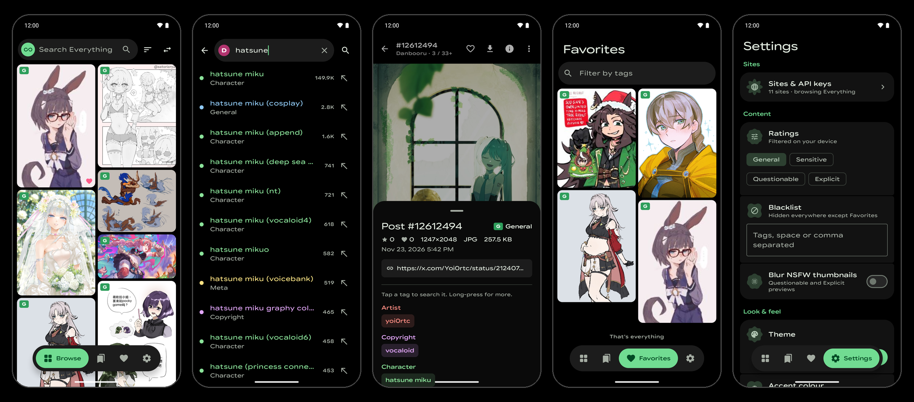
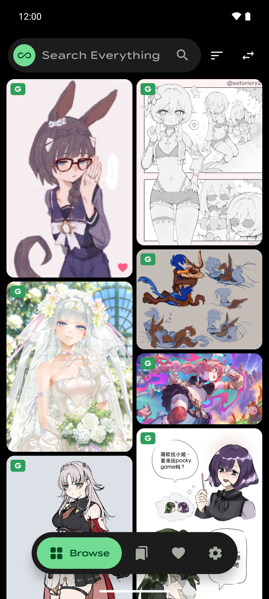
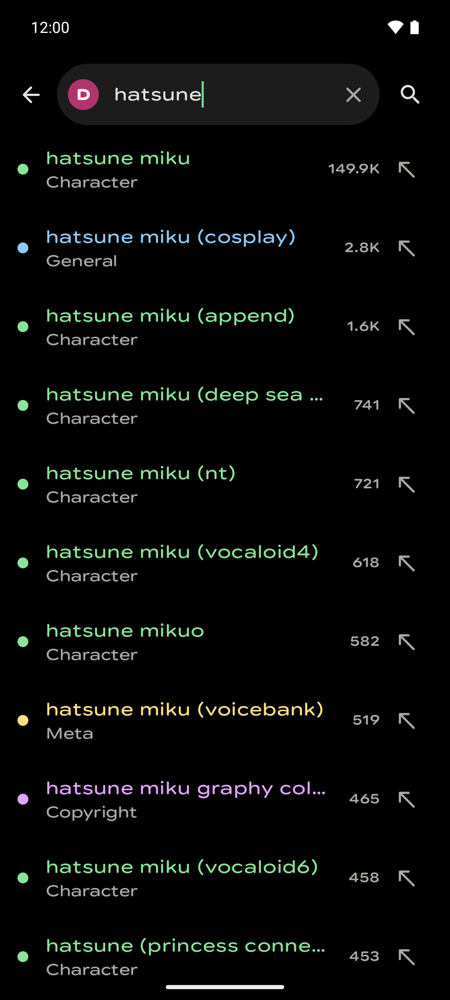
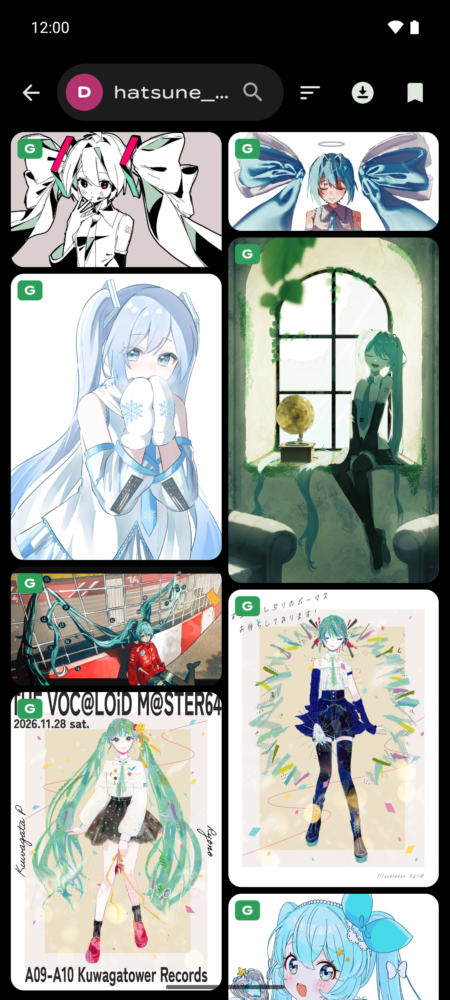
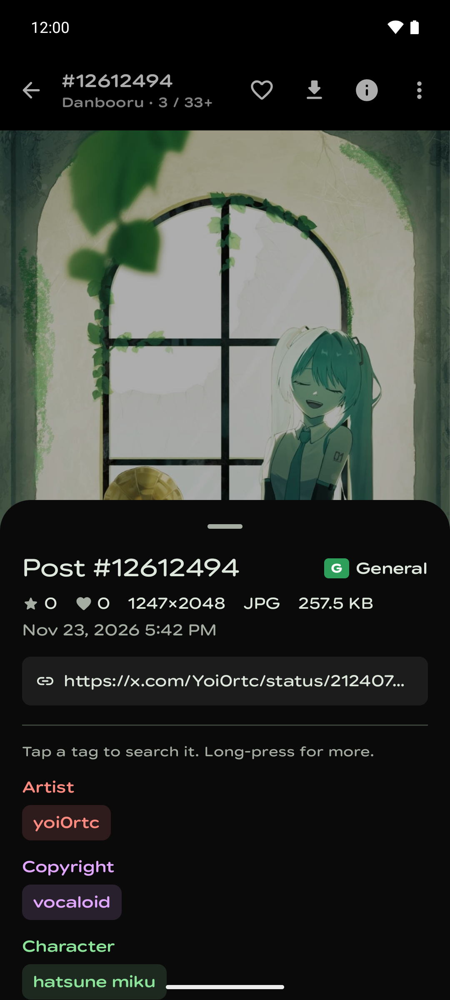
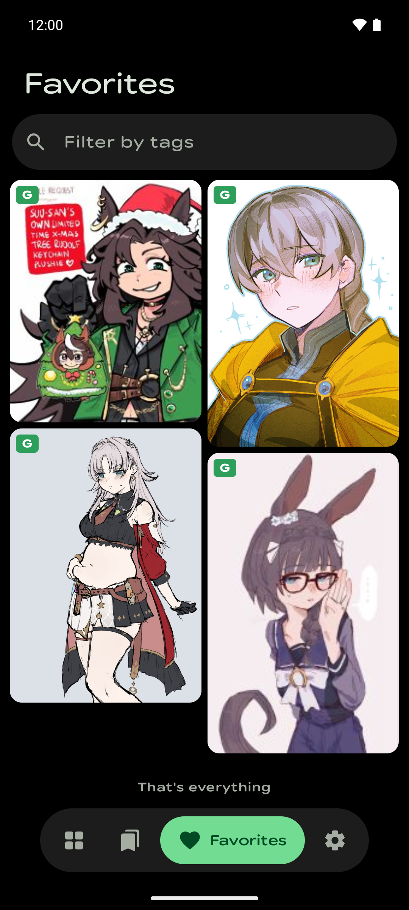
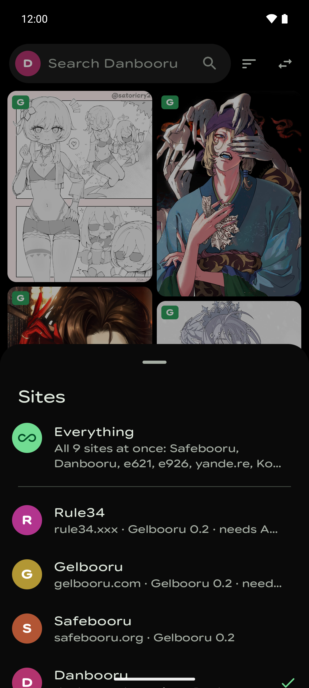
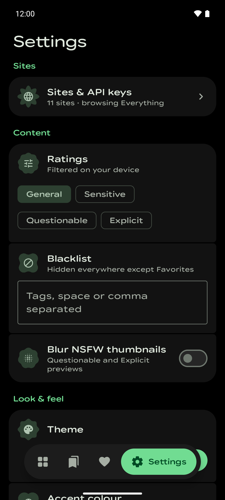

<div align="center">


# Expressive Booru

**A fast, private booru client for Android, built with Material 3 Expressive.**
Rule34, Gelbooru, Danbooru, e621, yande.re, Konachan and more, in one app. No ads, no tracking, no account needed.

[](https://github.com/visiuun/expressive-booru/releases/latest)
[](#compatibility)
[](LICENSE)
[](https://github.com/visiuun/expressive-booru/actions)



### [⬇ Download the latest APK](https://github.com/visiuun/expressive-booru/releases/latest)

</div>

> [!IMPORTANT]
> Expressive Booru is a client for image boards, and many of them host **adult (18+) content**. You choose which sites to use and which ratings you see. The screenshots here use Safebooru and Danbooru with only **General** posts shown.

---

## Quick start

1. **Install** the APK from the [latest release](https://github.com/visiuun/expressive-booru/releases/latest).
2. **Pick a site**: tap the round avatar in the search bar. Choose **Everything** to browse every site at once, or a single site.
3. **Search**: tap the search bar and start typing a tag. Suggestions show up as you type, coloured by type (artist, character, series…).
4. **Open a post**: tap a thumbnail. Swipe left and right to go through results, pinch to zoom, tap **ⓘ** for the tags.
5. **Keep things**: tap ♡ to favorite (or long-press a thumbnail), ⤓ to download, the bookmark to save a search.

### Search examples

| Type this | To get |
|---|---|
| `cat_ears 1girl` | posts that have **both** tags |
| `cat_ears -monochrome` | `cat_ears`, but **not** monochrome |
| `hatsune_miku sort:score` | the **highest rated** first (the sort button does this for you) |
| `artist_name` then **⤓ Download all** | **every** post by that artist, saved to your phone |
| `id:12345` | one specific post |
| `rating:general` | only safe-for-work posts, filtered by the site itself |

Tag names use underscores instead of spaces. Each site has its own tag names (`cat_ears` on Danbooru is `cat_ears`, on e621 it's often a species tag such as `domestic_cat`), so let the suggestions guide you. Danbooru only allows 2 tags per search without an account.

## The app

<table>
  <tr>
    <td></td>
    <td></td>
    <td></td>
    <td></td>
  </tr>
  <tr align="center">
    <td>Everything feed</td>
    <td>Tag suggestions</td>
    <td>Results</td>
    <td>Viewer</td>
  </tr>
  <tr>
    <td></td>
    <td></td>
    <td></td>
    <td></td>
  </tr>
  <tr align="center">
    <td>Tags & details</td>
    <td>Favorites</td>
    <td>Site picker</td>
    <td>Settings</td>
  </tr>
</table>

- **Every major booru in one app**: Rule34, Gelbooru, Safebooru, Danbooru, e621, e926, yande.re, Konachan, Xbooru, TBIB and HypnoHub built in, plus **any other site** running Gelbooru, Danbooru, e621 or Moebooru software
- **Everything**: browse or search **all your sites at once**. Results are mixed together and duplicates (the same image posted to several sites) are removed
- **Tag search with suggestions** as you type, with post counts and colours for artists, characters, series, species and meta tags. Exclude tags with `-`, sort by newest, top score or random
- **A grid that keeps each image's shape**, 1 to 5 columns, and endless scrolling. Long-press any thumbnail to favorite it
- **Full-screen viewer**: swipe through results (more load as you go), pinch and double-tap to zoom, **GIFs** and **videos** (webm, mp4) play inline, full-resolution or resized images
- **Post details**: score, size, date, source link and tags grouped by type. Tap a tag to search it, or long-press it to add it to the current search, exclude it, blacklist it or copy it
- **Download** single posts or **download everything** from a search (up to 3,000 posts), straight to your Downloads folder, named `[artist] - filename_site.ext` (just `filename_site.ext` when the site doesn't say who the artist is). Already downloaded posts are skipped next time
- **Favorites** across every site, kept on your phone, filterable by site and tags
- **Saved searches** and search history
- **Content filters**: choose which ratings you see (General, Sensitive, Questionable, Explicit), blacklist tags, and blur NSFW thumbnails
- **Open links** from the browser or share them to the app: a post link opens that post, a search link opens that search
- **Backup**: export and import your favorites, saved searches and custom sites as one file
- **Automatic updates** straight from this repository's releases
- **Make it yours**: Material 3 Expressive design with Google Sans Flex, light, dark and **OLED black**, and your **wallpaper colours** (Material You) or one of seven accents

## Sites

| Site | Software | Account needed? |
|---|---|---|
| **Rule34** (rule34.xxx) | Gelbooru 0.2 | **Yes**, a free API key |
| **Gelbooru** | Gelbooru 0.2 | **Yes**, a free API key |
| **Safebooru** | Gelbooru 0.2 | No |
| **Danbooru** | Danbooru | No (an API key lifts the 2-tag limit) |
| **e621** / **e926** | e621 | No (an API key shows posts hidden from guests) |
| **yande.re**, **Konachan** | Moebooru | No |
| **Xbooru**, **TBIB**, **HypnoHub** | Gelbooru 0.2 | No |

Sites that need a key are left out of **Everything** until you add one.

### Add your Rule34 or Gelbooru API key

1. Log in to the site in your browser and open **My Account → Options** ([Rule34](https://rule34.xxx/index.php?page=account&s=options), [Gelbooru](https://gelbooru.com/index.php?page=account&s=options)).
2. Under **API Access Credentials**, copy the line that looks like `&api_key=…&user_id=…`.
3. In the app go to **Settings → Sites & API keys**, tap the site, and paste the whole line into **API key**. The app splits it into the key and user ID for you.
4. Tap **Test**, then **Save**.

Danbooru and e621 work the same way: your **username** and the **API key** from your profile page.

### Add another site

**Settings → Sites & API keys → Add a site**. Give it a name, pick its software (Gelbooru 0.2, Danbooru, e621 or Moebooru), enter its address and tap **Test**.

## Install

1. Open the **[latest release](https://github.com/visiuun/expressive-booru/releases/latest)** on your phone and download `Expressive-Booru-x.y.z.apk`.
2. Open the downloaded file. If Android asks, allow your browser or file manager to **install unknown apps**.
3. Tap **Install**.

### Updates

The app checks this repository's **Releases** when it starts (at most every 6 hours) and offers new versions in a dialog with what's new. Tap **Update** and Android asks you to confirm the install. The first time, Android asks you to allow Expressive Booru to install apps. You can turn automatic checks off or check by hand in *Settings → Updates*.

## Privacy

- **No accounts, ads, analytics or trackers.** Favorites, history, downloads and settings stay on your phone.
- The app only talks to the sites you browse. API keys are stored on your phone, sent only to their own site, and **never** included in backups.
- Downloads go through Android's own download manager.
- The update check is a single anonymous request to the public GitHub API, and can be turned off.

## Compatibility

| | |
|---|---|
| **Android** | 8.0 (API 26) and newer, tested up to Android 16 |
| **Devices** | Phones, tablets and foldables |
| **APK** | One universal APK for every CPU type |
| **Google services** | Not needed |

## Build it yourself

You need a **JDK 17 or newer**. Everything else (Gradle, the Android Gradle Plugin, every library and the required Android SDK platform) is downloaded automatically on the first build.

```bash
git clone https://github.com/visiuun/expressive-booru.git
cd expressive-booru
./gradlew assembleRelease        # Windows: gradlew.bat assembleRelease
```

The APK ends up in `app/build/outputs/apk/release/`. Or open the folder in **Android Studio** and press *Run*.

If you don't already have the Android SDK, install [Android Studio](https://developer.android.com/studio) or the command-line tools once and point `ANDROID_HOME` (or `sdk.dir` in `local.properties`) at it.

<details>
<summary><b>Signing your own release builds</b></summary>

Without a key, release builds are signed with the debug key, which is fine for trying things out. To sign with your own key, create `keystore.properties` in the project root (it is git-ignored):

```properties
storeFile=keystore/release.jks
storePassword=your-store-password
keyAlias=your-alias
keyPassword=your-key-password
```

Or set the environment variables `SIGNING_STORE_FILE`, `SIGNING_STORE_PASSWORD`, `SIGNING_KEY_ALIAS` and `SIGNING_KEY_PASSWORD`.

Android only installs an update over an existing app if both are signed with the same key, so builds you sign yourself can't update the official release, and vice versa.

</details>

<details>
<summary><b>Project structure</b></summary>

```
app/src/main/java/dev/vis/booru/
├── data/   booru API client (Gelbooru 0.2, Danbooru, e621, Moebooru), feeds and the Everything merge,
│           downloads, favorites, searches, settings and backup
└── ui/     Jetpack Compose screens: browse, search, viewer, favorites, searches, settings, sites
    ├── components/   post grid, pill navigation, settings rows, shape badges
    └── theme/        colour schemes, accents, Google Sans Flex typography
```

Built with Kotlin, Jetpack Compose and Material 3 Expressive, plus [Coil](https://coil-kt.github.io/coil/) for images, [Telephoto](https://github.com/saket/telephoto) for zooming, [Media3 ExoPlayer](https://developer.android.com/media/media3) for video, [OkHttp](https://square.github.io/okhttp/) and [material-color-utilities](https://github.com/jordond/MaterialKolor).

</details>

## Contributing

Bug reports, ideas and pull requests are welcome. Please [open an issue](https://github.com/visiuun/expressive-booru/issues) first for larger changes. If a site stops working, an issue with the site name and what you searched helps a lot.

## Credits

- Images and tags come from the sites you connect to and belong to their artists. Please support the artists you like.
- Font: **Google Sans Flex** (SIL Open Font License, included in the app).
- Shapes, motion and colour from Google's **Material 3 Expressive**. Design shared with **[Expressive Weather](https://github.com/visiuun/expressive-weather)**.

## License

**[CC BY-NC 4.0](LICENSE)**: you're free to use, change, fork and share this project for anything **non-commercial**, as long as you **credit it** with "Expressive Booru by visiuun" and a link to this repository, and say what you changed. Commercial use of any kind (selling it, paywalls, ads) is not allowed.

© 2026 visiuun
